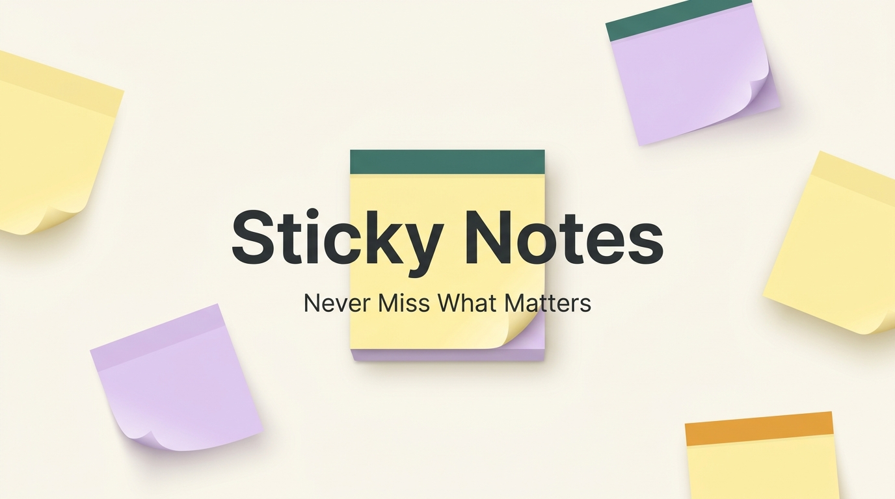
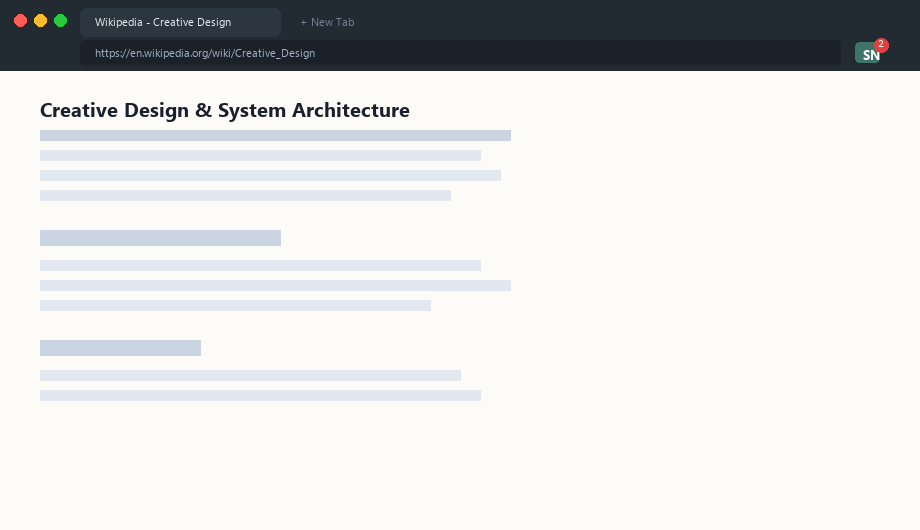
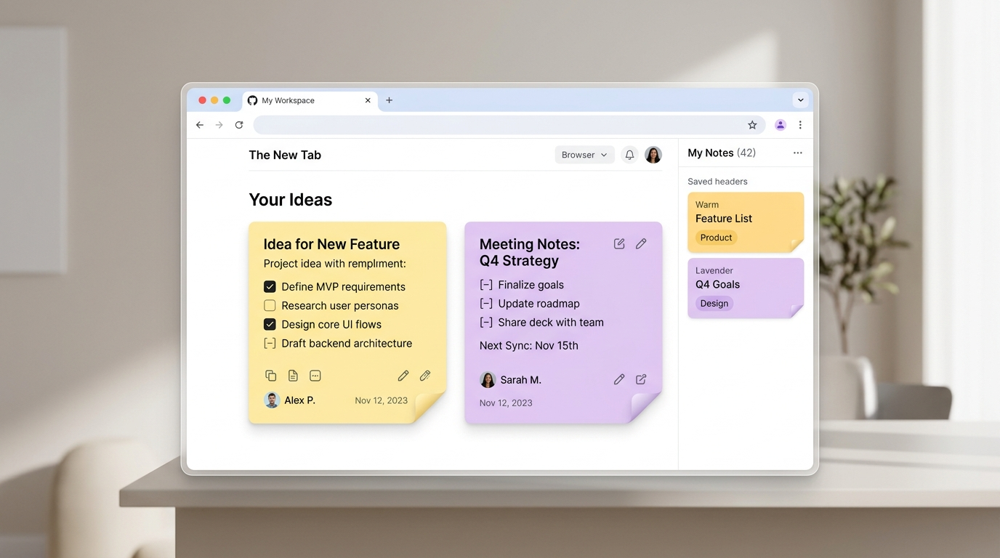

<div align="center">

  

  # 📌 Sticky Notes
  ### *Never Miss What Matters While Browsing*

  [](https://developer.chrome.com/docs/extensions/mv3/intro/)
  [](manifest.json)
  [](README.md#license)
  [](https://chrome.google.com/webstore)

  <p align="center">
    A sleek, lightweight, and privacy-first note-taking companion for Chrome.<br />
    Capture ideas, quotes, tasks, and links, organize them by website and category, and drag floating post-its directly onto any webpage.
  </p>

  <br />

  <!-- Animated Live Demo -->
  

</div>

---

## ✨ Features at a Glance

<div align="center">
  
</div>

| Feature | Description |
| :--- | :--- |
| 🪟 **Floating Post-Its** | Drag any note from the menu onto a webpage as a floating post-it that remembers its coordinates after page reloads. |
| 🏷️ **Smart Organization** | Organize notes with custom categories, tags (`#ideas`, `#quotes`), and mark important notes as favorites (★). |
| 🌐 **Site-Specific Context** | Automatically associates notes with the active website. Filter notes by the current domain with a single click. |
| 🔢 **Live Tab Badge Counter** | Real-time badge counter on the Chrome toolbar icon displays how many notes you have for the active website. |
| 🔀 **Flexible Sorting** | Sort notes by **Newest First**, **Oldest First**, **A - Z**, or **Favorites First**. |
| 📑 **Popup & Side Panel Modes** | Seamlessly switch between a compact toolbar popup and a full-height Chrome Side Panel. |
| ✂️ **Right-Click Web Clipper** | Highlight any text on any webpage, right-click, and select *„Save selection to Sticky Notes”*. |
| 🎨 **Themes & Accents** | Built-in Light, Dark, and System color schemes with customizable accent colors (Teal, Amber, Blue, Rose). |
| 💾 **Backup & Restore** | Export and restore notes with clean, validated JSON backups. |
| 🛡️ **100% Private & Offline** | Zero trackers, zero analytics, zero external servers. Your notes stay strictly in your browser storage. |

---

## 📸 Interface Preview

<div align="center">

| Main Menu & Notes List | Rich Text Note Editor |
| :---: | :---: |
|  |  |

</div>

---

## ⌨️ Keyboard Shortcuts

| Shortcut | Action |
| :--- | :--- |
| `Ctrl + Shift + N` *(Mac: `Cmd + Shift + N`)* | Open Sticky Notes |
| `Ctrl + B` | Bold selected text |
| `Ctrl + I` | Italic selected text |
| `Ctrl + U` | Underline selected text |
| `Space` / `Enter` / `,` | Add tag in tag editor |
| `Esc` | Close delete confirmation dialog |

---

## 🚀 Installation & Local Setup

### For Local Development:
1. Clone this repository or download the source code:
   ```bash
   git clone https://github.com/RhadooToma/sticky-notes.git
   ```
2. Open Google Chrome and navigate to:
   ```text
   chrome://extensions
   ```
3. Enable **Developer mode** toggle in the top-right corner.
4. Click **Load unpacked** in the top-left and select this project directory.
5. Pin **Sticky Notes** from the Chrome extensions toolbar menu (🧩).

### For Chrome Web Store:
The extension is packaged for Chrome Web Store distribution as `StickyNotes-extension.zip` containing `manifest.json` at its root.

---

## 🔒 Privacy & Permissions

Sticky Notes is built with privacy at its core:
* **`storage`**: Saves notes, categories, and theme preferences locally with Chrome Sync.
* **`tabs`**: Identifies the domain of the active tab to associate notes with websites and display the badge counter.
* **`contextMenus`**: Lets you save text selected on a webpage from the right-click menu.
* **`sidePanel`**: Enables opening notes inside Chrome's native side panel.
* **No external servers, tracking cookies, or third-party analytics are used.**

---

## 🛠️ Built With

* **Manifest V3** – Modern, secure, and future-proof Chrome Extensions architecture.
* **Vanilla JavaScript (ES6+)** – Zero runtime dependencies, fast execution, and ultra-lightweight bundle.
* **CSS3** – Fluid flexbox layout, CSS custom properties, and responsive dark/light themes.

---

## 📄 License

Distributed under the **MIT License**.

```text
MIT License

Copyright (c) 2026 RhadooToma

Permission is hereby granted, free of charge, to any person obtaining a copy
of this software and associated documentation files (the "Software"), to deal
in the Software without restriction, including without limitation the rights
to use, copy, modify, merge, publish, distribute, sublicense, and/or sell
copies of the Software, and to permit persons to whom the Software is
furnished to do so, subject to the following conditions:

The above copyright notice and this permission notice shall be included in all
copies or substantial portions of the Software.

THE SOFTWARE IS PROVIDED "AS IS", WITHOUT WARRANTY OF ANY KIND, EXPRESS OR
IMPLIED, INCLUDING BUT NOT LIMITED TO THE WARRANTIES OF MERCHANTABILITY,
FITNESS FOR A PARTICULAR PURPOSE AND NONINFRINGEMENT. IN NO EVENT SHALL THE
AUTHORS OR COPYRIGHT HOLDERS BE LIABLE FOR ANY CLAIM, DAMAGES OR OTHER
LIABILITY, WHETHER IN AN ACTION OF CONTRACT, TORT OR OTHERWISE, ARISING FROM,
OUT OF OR IN CONNECTION WITH THE SOFTWARE OR THE USE OR OTHER DEALINGS IN THE
SOFTWARE.
```
